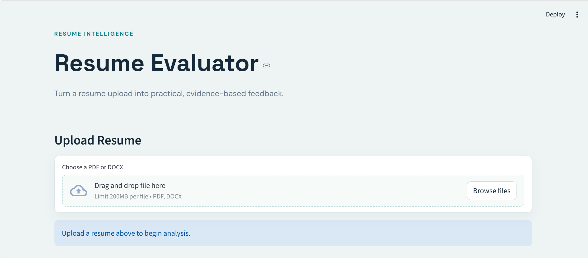
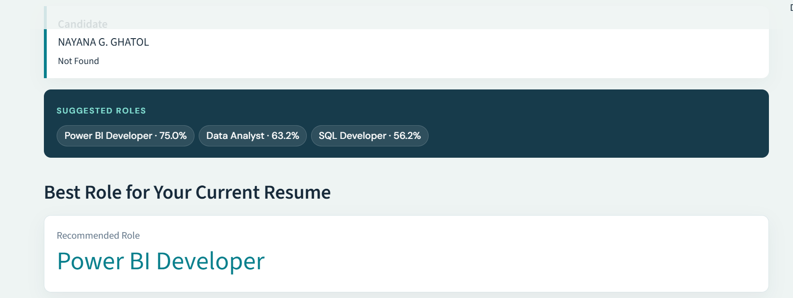
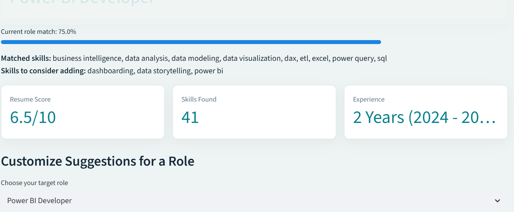
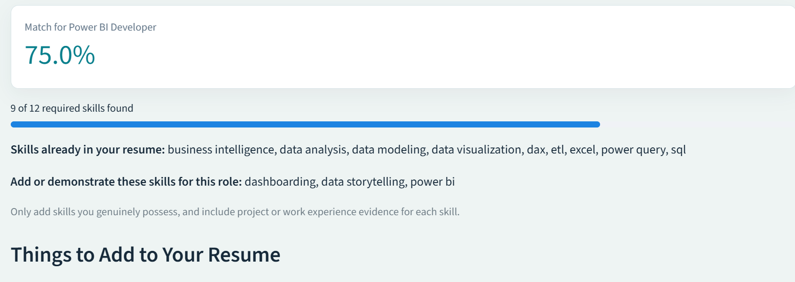
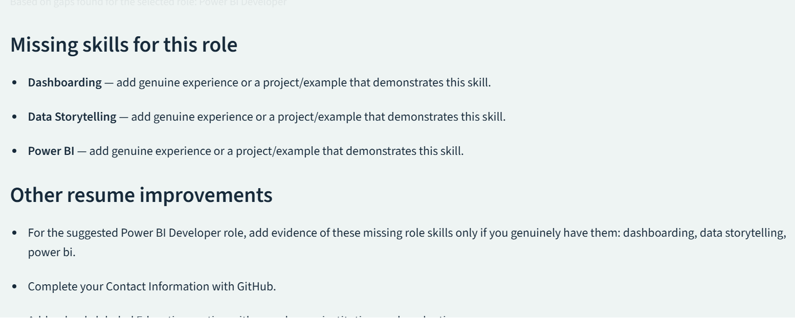
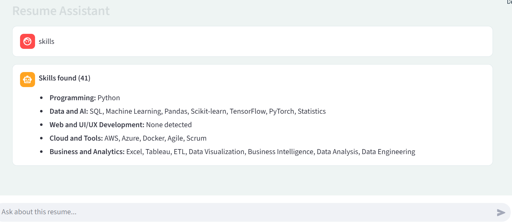

# Resume-Evaluator
A Streamlit app that scores uploaded resumes, detects skills, suggests job roles, identifies skill gaps, and answers questions about resume content.
## Features
- Upload Resumes as PDF or DOCX.
- Accepts resumes in PDF and DOCX formats and extracts their text.
- Identifies candidate details, skills, experience, education, and contact information.
- Provides a resume score and suggestions for improvement.
- Recommends suitable job roles and compares resume skills against role requirements.
- Highlights skill gaps and offers role-focused suggestions.
- Includes a chat-style assistant for questions about the uploaded resume 
## Tools Used
- Python — handles the application logic.
- Streamlit — provides the web app interface and user interactions.
- pypdf — extracts text from PDF files.
- python-docx — extracts text from DOCX files.
- Python standard library (io, re, and datetime) — supports file handling, text processing, and date operations.
- HTML, CSS, and Google Fonts — provide custom styling.
## How to Run
- python -m streamlit run Validator_code.py 
  

 

 

 

 

 

